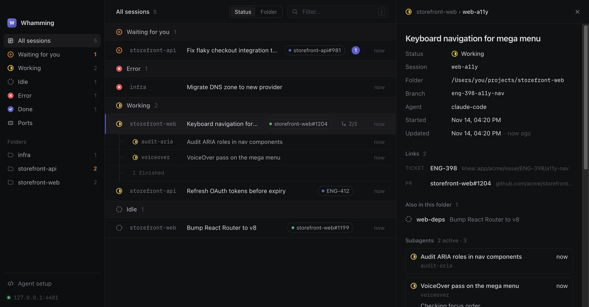
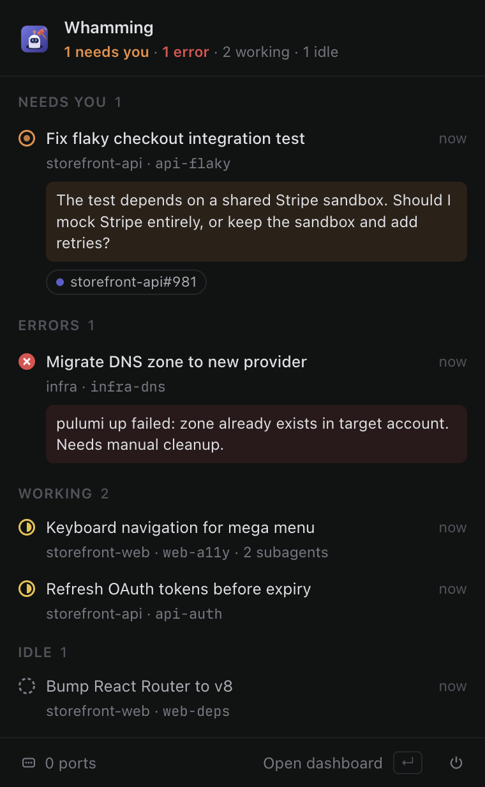

# Whamming (What am I working on?)

**See what all your Claude Code sessions are working on, at a glance.**

When you have several Claude Code sessions going at once, across repos and tickets, it's easy to lose track of
which one is waiting for you, what each is doing, and which PR belongs to which. Whamming is a small local
dashboard that answers that: folder, status (working, waiting for you, idle, error), the task, and links to
the tickets and PRs involved. Agents can also find each other, message each other, and claim ports so
parallel sessions don't fight over `5432`.

> **Prototype.** Whamming is an early, macOS-only prototype built around **Claude Code**. It relies on
> Claude Code hooks and on reading Claude Code's own session files (`~/.claude/sessions/*.json`, an internal
> format that may change). The HTTP API is generic, so other agents can report too, but only Claude Code is
> set up out of the box. Expect rough edges and breaking changes.





## What it does

- **Live overview** of every session, grouped by status or folder, Linear-style. What needs you comes first,
  with the agent's question.
- **Menu bar icon** with the number of sessions waiting for you, and a popover with the quick overview.
  Dock badge, notifications when an agent starts waiting or hits an error, and a Dock menu to jump to a session.
- **Automatic status** through Claude Code hooks: working, idle and permission prompts are tracked without the
  agent having to remember. Agents add titles, questions, and links to tickets and PRs.
- **Subagents** show up as child rows under the session that spawned them.
- **Coordination**: agents can ask who else works in the same folder, and leave each other messages.
- **Port claims**: agents ask Whamming for a port before binding one, checked against other agents'
  claims and what's actually listening, including docker compose containers.
- **Notices exits** within about 2 seconds (Ctrl-C, crash, closed terminal, `/clear`) without slowing Claude's
  exit, and merges a resumed session (`claude -r`) back into its old entry.

<br clear="right">

## Install

Requirements: macOS, Node.js 20+, Go 1.24+ (to build the CLI), and Claude Code.

```sh
git clone https://github.com/trondhindenes/whamming.git
cd whamming
npm install
npm run package                       # builds release/Whamming-darwin-<arch>/Whamming.app
open release/Whamming-darwin-*/Whamming.app
```

Copy `Whamming.app` to `/Applications` if you like. The build is signed ad hoc for your own machine; it isn't
notarized for distribution.

Then open **Agent setup** (bottom left in the dashboard) and follow the three steps:

1. **Install the command line tool.** Links `~/.local/bin/whamming` to the CLI inside the app. The link follows
   the app if you move or update it.
2. **Install the Claude Code hooks.** Shows exactly what will be added to `~/.claude/settings.json` before
   changing anything, keeps your existing hooks, and saves a backup first. The hook prints nothing, never
   fails, and gives up after 0.8 s if Whamming isn't running. *Remove* takes them out again.
3. **Add the agent instructions** to your global `~/.claude/CLAUDE.md`, so agents report titles, questions,
   links, ports and subagents, and check for other sessions in the same folder.

New Claude Code sessions show up automatically from then on.

## How it works

```
Claude Code ──hooks──▶ whamming hook ─┐
     │                                 ├──▶ Whamming server (127.0.0.1:4477) ──▶ dashboard, menu bar, Dock
     └─ agent runs ─▶ whamming update ─┘        state: ~/.whamming/state.json
```

- **Identity.** The CLI walks up its process tree to the Claude Code process and reads that session's file
  for its name (the one set with `/rename`, or Claude's generated name) and its process ID. Sessions are keyed
  by name; the process ID tells two sessions with the same name apart, which the dashboard flags as a
  *name clash*. A `/rename` moves the entry to the new name.
- **Status.** Hooks: a prompt → *working* (plus a provisional title from the prompt until the agent sets one);
  a permission prompt → *waiting*; the next tool call → *working*; the end of a turn → *idle*. Hooks never
  override a status the agent set itself (*waiting* with a question, *error*, *done*).
- **Exits.** Every 2 seconds the server checks each session's process and Claude's session file. Ended
  sessions move to *Exited*, release their port claims, and are kept for 3 days so a resume can merge into them.
- **Subagents** run inside their parent's process, so they can't be told apart automatically. They report
  with `--task <key>`, and the parent passes them the key when it spawns them.
- **Finding the server.** While it runs, Whamming writes `~/.whamming/status.json` (`pid`, `port`, `url`,
  `version`). The CLI uses `WHAMMING_URL` / `WHAMMING_PORT`, then that file, then port 4477. A stale file
  (its process is gone) means "not running", without a network attempt. If 4477 is taken, the server uses
  the next free port. Two instances never serve the same data folder: a second one reuses the first.

## The CLI

```sh
whamming whoami                                    # resolved session name and pid
whamming update --title "Fix login redirect loop" --link https://linear.app/acme/issue/ENG-42
whamming update --status waiting --detail "Mock Stripe or keep the sandbox?"
whamming done
whamming update --task review-auth --title "Review auth middleware"   # a subagent's child row
whamming peers                                     # who else works in this folder
whamming send <session> "heads up: I'm editing src/payments"
whamming inbox
PG_PORT=$(whamming port claim --prefer 5432 --purpose postgres)      # 5432 if free, else another free port
whamming port release --all
whamming ports                                     # who holds what, and unclaimed listeners
whamming ping                                      # is Whamming running, where, which version
```

Statuses: `working`, `waiting`, `idle`, `done`, `error`. `--id` / `WHAMMING_SESSION` set the name for non-Claude
agents. Run `whamming --help` for everything.

## API

The server listens on `127.0.0.1` only. Requests that come from a browser page other than the dashboard
itself are rejected, and the setup endpoints (which change `~/.claude/settings.json` and `~/.local/bin`) only
accept requests from the dashboard.

| Method | Path | |
|---|---|---|
| `PUT`/`PATCH` | `/api/sessions/:id` | Create or update. `folder` (required on create), `status`, `title`, `detail`, `branch`, `name`, `agent`, `pid`, `claudeSessionId`, `links[]`, `note`, `replaceLinks` |
| `GET` | `/api/sessions?folder=&status=` | List |
| `GET` | `/api/sessions/:id` | One session, with its activity log |
| `DELETE` | `/api/sessions/:id` | Remove |
| `DELETE` | `/api/sessions?olderThanHours=` | Prune finished (and old) sessions |
| `POST` | `/api/sessions/:id/heartbeat` | Bump `updatedAt` |
| `PUT`/`PATCH` | `/api/sessions/:id/tasks/:key` | A subagent's child row: `{title?, status?, detail?, links?, note?}` |
| `DELETE` | `/api/sessions/:id/tasks/:key` | Remove a child row |
| `GET` | `/api/peers?folder=&exclude=&excludePid=` | Sessions in the same, parent or child folder |
| `GET` | `/api/sessions/:id/peers` | Same, for a known session |
| `POST` | `/api/sessions/:id/messages` | `{from, body}`: leave a message |
| `GET` | `/api/sessions/:id/messages?unread=1&markRead=0` | Read the inbox (marks as read by default) |
| `POST` | `/api/ports/claim` | `{session, pid?, folder?, port? \| prefer?, purpose?, adopt?}` → `201 {lease}` or `409 {error, conflict}` |
| `GET` | `/api/ports` | `{leases, unclaimed}` with live listener info |
| `GET` | `/api/ports/:port` | `{state: free \| claimed \| in-use}` |
| `DELETE` | `/api/ports/:port?session=&pid=` | Release a claim |
| `DELETE` | `/api/ports?session=&pid=` | Release all of a session's claims |
| `POST` | `/api/hooks/claude` | A Claude Code hook event, forwarded by `whamming hook` |
| `GET` | `/api/stream` | Server-sent events on every change |
| `GET` | `/api/health` | `{ok, app, version, pid, home}` |
| `GET` | `/api/info` | `{cliPath}` |
| `GET` | `/api/setup` | CLI and hooks install status |
| `POST` | `/api/setup/cli` | Install the CLI link (dashboard only) |
| `GET` | `/api/setup/hooks/preview` | The hook entries that would be added |
| `POST`/`DELETE` | `/api/setup/hooks` | Install or remove the hooks (dashboard only; backs up first) |

## Development

```sh
npm start            # build, then run the Electron app from source
npm run server       # headless server; open http://127.0.0.1:4477 in a browser
npm run demo         # fill a running instance with example sessions
npm run typecheck
npm run icons        # re-render assets/*.svg to PNG + .icns
npm run package      # build Whamming.app
```

Run a second instance next to your real one with its own data, profile and port:

```sh
WHAMMING_HOME=/tmp/wh-dev WHAMMING_USER_DATA=/tmp/wh-dev/profile WHAMMING_PORT=4499 npm start
```

| | |
|---|---|
| `src/server/` | Store (JSON persistence in `~/.whamming`), HTTP API, ports, setup, status file |
| `src/main/` | Electron shell: window, menu bar popover, Dock, notifications |
| `src/renderer/` | Dashboard and popover (TypeScript, no framework) |
| `cli/` | The `whamming` CLI (Go, no dependencies), bundled into the app |
| `docs/agent-instructions.md` | The snippet shown in *Agent setup* |
| `assets/` | Icons (SVG sources and rendered files) |

## License

[MIT](LICENSE)
